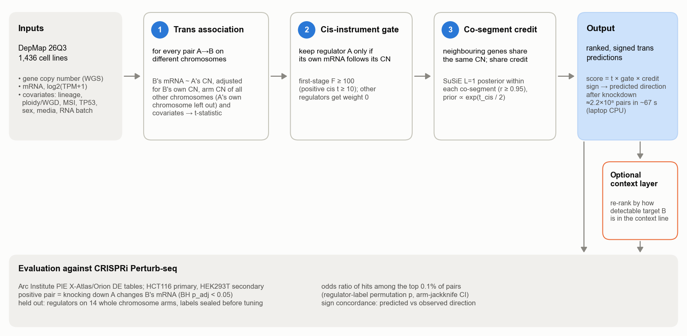

# DepMapTR — trans-transcriptomic consequences of copy-number change (AI hackathon project)

AI-generated project — see the Disclaimer below.

**In one sentence:** DepMapTR asks which genes change expression when another gene's copy number changes; it takes
matched copy-number and RNA-seq profiles of 1,436 DepMap cancer cell lines, scores all 210 million pairs of genes on
different chromosomes for how well the copy number of a regulator gene A predicts the mRNA of a target gene B once
confounders are removed, and outputs a ranked list of regulator→target pairs with a predicted direction of change.

## The method in five steps

1. **Association.** Regress B's mRNA on A's copy number across lines, adjusting for B's own copy number, lineage,
   ploidy, culture and other covariates, and the copy number of every chromosome arm *outside* A's chromosome
   (expression factors are deliberately not used; their expected harm is taken from the literature, not tested here).
2. **Cis gate.** Keep A only if its own mRNA rises strongly with its own copy number (adjusted t ≥ 10, i.e. first-stage
   F ≥ 100); 5,403 of 12,141 regulators pass, the rest score 0.
3. **Attribution.** Within blocks of genes that are always gained and lost together (r ≥ 0.95), share each signal by
   single-effect fine-mapping, favouring the gene whose mRNA tracks its dosage best (not separately tested on held-out
   data).
4. **Score and direction.** S = t × gate × attribution share; rank pairs by |S|; predict the opposite sign on knockdown.
5. **Optional context layer.** Re-weight by the target's expression in one cell line (HCT116), to rank what a screen
   there can detect; reported separately, not part of the method (held-out OR 18.4, no better than a label-free hub
   prior, 22.8).

## Key results (held-out regulators on 14 chromosome arms, HCT116 CRISPRi Perturb-seq)

| finding | evidence | strength |
|---|---|---|
| The cis gate improves enrichment | OR 1.46 → 3.85; +0.97 log-OR (95% CI 0.30–1.64); replicates training | shown, replicated |
| The ranking enriches Perturb-seq hits | top-0.1% OR 3.85 (CI 1.33–11.2); pre-registered permutation p = 0.068; not significantly above a shuffled-copy-number control (+1.10 log-OR, CI −0.66 to 2.85) | suggestive, not significant |
| It ranks targets within a regulator | per-regulator AUROC 0.500 (0.5 = chance); regulator-stratified OR 0.94 (CI 0.77–1.15) | no: none detected |
| It predicts the direction of change | 71.8% vs 64.7% (p = 0.012), but a shuffled-copy-number control passes the same test (p = 0.001) | not established |
| It beats simple baselines | below co-expression (6.03), target expression (7.39) and a label-free hub prior (22.8); no paired difference significant | not shown |
| It works in a second line | HEK293T OR 0.49 (6 overlaps) | not shown |

In short: the results suggest that copy number says something about *which regulators* have trans effects detectable
by CRISPRi (the cis gate's gain replicated, but the overall enrichment was not significant); no information about
*which targets* respond was detected. A full run scores all pairs in 67 s on a 10-core laptop CPU.

**Read more:** interactive explainer [`docs/site/index.html`](docs/site/index.html) (open locally; rebuild with
`python scripts/figures/build_site.py`) · [Method](docs/site/METHOD.md) · [How we got here](docs/site/JOURNEY.md) ·
[Insights](docs/site/INSIGHTS.md) · [REPORT.md](REPORT.md) · [BRIEFING.md](docs/briefing/BRIEFING.md)

## Disclaimer

This is an exercise in assessing the bioinformatics capabilities of agentic AI. This particular exercise was run by the Ryan lab at University College Dublin as part of a larger hackathon run by the Beltrao lab at ETH Zurich, where we used Claude to run bioinformatics projects. All results in this project were generated entirely by AI with minimal human intervention. This is not intended to be viewed as a traditional publication and bioinformatics tool.

Models and machine: the project was run in Claude Code. The PI agent and most sub-agents (data, benchmark harness, model engine, literature, design and code reviewers) used Claude Opus 5.5 (`claude-opus-5-5`); some reviewers and the retrospectives used Claude Sonnet 5.5 (`claude-sonnet-5-5`). All computation ran locally on an Apple M4 laptop (10 CPU cores, 32 GB RAM, no GPU).

Currently none of the results have been verified by a human. We plan to verify the agent’s methodology and benchmarking, and we will update this section accordingly.

The rest of this repository is entirely AI generated. It includes code for implementation of the predictive model and a AI-written report in the style of a journal article, detailing the final method, the path followed to reach it, and benchmarking against other methods.

## What is here

| file / directory | contents |
|---|---|
| `PROMPT.md` | the project brief, verbatim |
| `REPORT.md` | final report: approach, results on held-out regulators, limitations, follow-ups |
| `RESEARCH_TREE.md` | research log: status summaries, decision notes D0–D8a, tree of what was tried |
| `DESIGN.md` | design (v3.1, frozen after three review rounds) and dispositions of every review proposal |
| `LITERATURE.md` | literature review |
| `DATA.md` | data sources, versions, checksums and licences |
| `LESSONS.md` | process lessons for running agentic research projects |
| `docs/` | data profile, benchmark and model implementation notes, interfaces; `docs/site/` explainer (HTML + Markdown); `docs/briefing/figures/` figures |
| `reviews/` | all design, code, pre-final and report reviews, idea and retrospective reviews |
| `src/depmaptr/` | the tool (association engine, covariates, gates, attribution, simulation, benchmark harness) |
| `scripts/` | data preparation, model runs, evaluation, final evaluation |
| `tests/` | unit, simulation (known-answer) and real-data invariant tests |
| `results/` | committed metrics: tuning log, TRAIN comparisons, split definitions, the single locked TEST evaluation (`results/final/`) |

## Data

No data files are included in this repository. To reproduce, obtain the following and follow DATA.md and REPORT.md §8:
- the DepMap files listed in DATA.md (placed in `starting_data/`);
- the Arc Institute PIE X-Atlas/Orion DE tables (Hugging Face `arcinstitute/PIE_x_atlas_orion`, commit `abfa3da`; CC BY-NC-SA 4.0).

All data and derived score matrices are git-ignored.
