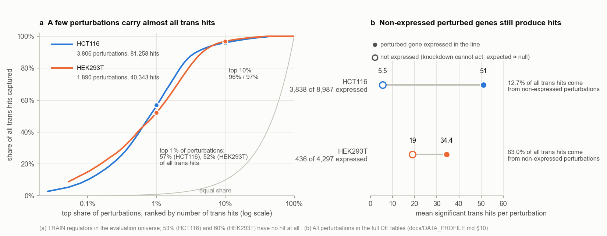
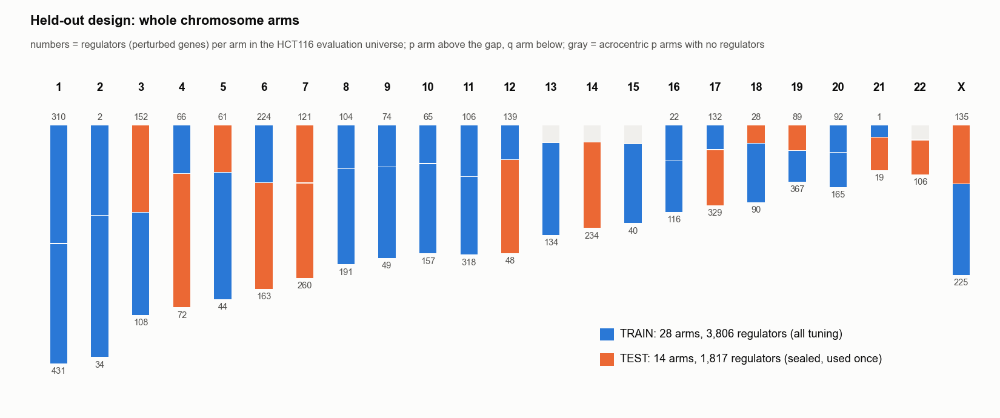
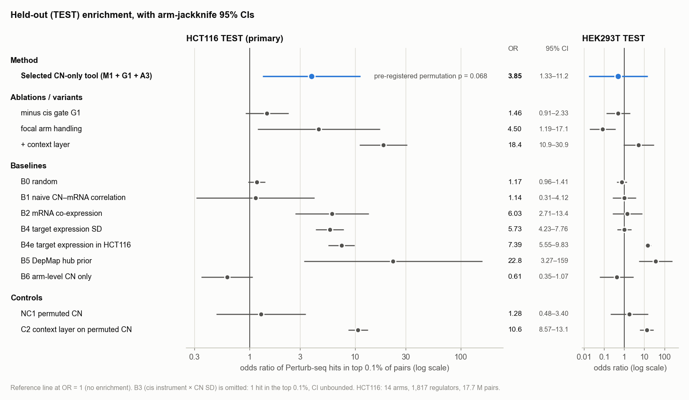
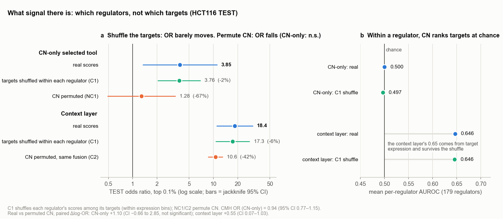
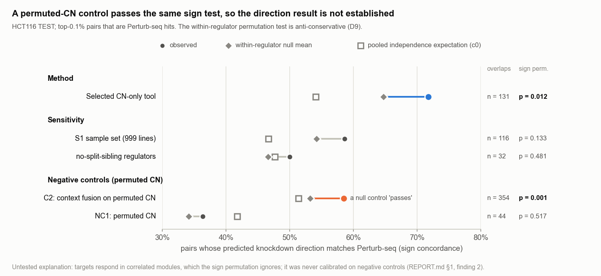

# Copy number as a natural experiment: what DepMap can and cannot say about trans gene regulation

*A research briefing on DepMapTR, an agent-run computational biology project (27 October 2026)*

**Abstract.** We asked whether natural copy-number variation across 1,436 DepMap cancer cell lines can predict which genes on *other* chromosomes change when a gene is knocked down. The benchmark was a CRISPRi Perturb-seq screen in HCT116 cells. The final tool regresses each target gene's expression on each candidate regulator's copy number, adjusting for lineage, culture conditions, ploidy and the copy number of every other chromosome's arms. It keeps only regulators whose own mRNA strongly tracks their copy number, and splits credit among co-amplified neighbours; it scores about 2.2 × 10⁸ gene pairs in about 67 s on a laptop. On regulators from 14 chromosome arms that were sealed before any tuning, the top 0.1% of predictions were enriched for Perturb-seq hits (odds ratio 3.85, 95% CI 1.33–11.2). That enrichment was not significant under the pre-registered permutation test (p = 0.068), and it did not replicate in a second cell line (HEK293T). The one robust ingredient was the gate on the regulator's own copy-number→mRNA link, but what it captures is *which regulators* have detectable effects, not *which of their targets* respond: label-free baselines that only encode regulator "hubness" and target detectability scored higher, and an apparent excess of correct effect directions failed its own negative control. The project was designed, run and reported by AI agents in about 5.5 hours, and its clearest lesson is methodological: on hub-dominated perturbation benchmarks, pooled enrichment must be broken into its parts before any of it is credited to a method.

This project was run end-to-end by AI agents (Claude Opus 5.5 / Sonnet 5.5) with minimal human input; results have not yet been verified by a human.

---

> **Glossary (terms used throughout)**
>
> - **Copy number (CN).** How many copies of a stretch of DNA a cell carries. DepMap reports *relative* CN: 1 means the same as the cell line's average (its ploidy), 2 means twice as many copies.
> - **Regulator (A) and target (B).** A is the gene whose copy number varies (and which Perturb-seq knocks down); B is the gene whose mRNA is measured.
> - **Cis / trans.** *Cis*: A's copy number acting on A's own mRNA. *Trans*: A's copy number acting on a gene B on a **different chromosome**. Only trans pairs are scored.
> - **Chromosome arm.** Each chromosome has a short (p) and a long (q) arm. Cancers often gain or lose whole arms, so thousands of genes change dosage together.
> - **Perturb-seq / CRISPRi.** CRISPR interference switches a gene's transcription down; Perturb-seq then measures the whole transcriptome of single cells to see which other genes changed. A **hit** is a (regulator, target) pair where knockdown of A significantly changed B.
> - **Odds ratio (OR).** How much more likely a pair is to be a hit if the method ranks it in its top 0.1% than if it does not. OR = 1 means no enrichment.
> - **TRAIN / TEST.** Regulators on 28 chromosome arms used for all tuning (TRAIN), and regulators on 14 other arms whose benchmark labels were sealed and used exactly once (TEST).
> - **Hub / detectability.** A few regulators produce most Perturb-seq hits (hubs), and highly expressed targets are much easier to detect as changed. Both can inflate an OR without any knowledge of specific pairs.
> - **t-statistic (t).** The strength of an association after adjustment, in units of its standard error. |t| ≈ 2 is borderline; |t| > 5 is strong.

---

## 1. The question, and why it is hard

**Main point: cancer cell lines contain thousands of natural dosage experiments, but those experiments are confounded in ways that make "gene A's copy number goes with gene B's expression" a weak and often misleading clue, and the best available test of the clue (Perturb-seq) measures something related but different.**

The project brief asked for a tool that predicts the transcriptomic consequences of a copy-number change: if a cell carries more or fewer copies of gene A, which genes elsewhere in the genome go up or down? The aim was explicitly not to find transcription factor–target links. Indirect effects (A → B → C) and non-transcriptional routes (for example through RNA-binding proteins) count too.

**Copy number as a natural perturbation.** Cancer genomes gain and lose DNA constantly, and for most genes mRNA follows dosage: across 77,840 expression profiles, copy number correlated positively with expression for 99% of abundantly expressed genes (Fehrmann et al. 2015). If the copy number of A changes A's own mRNA, and also tracks the mRNA of a distant gene B, then A may regulate B. This is the logic of Mendelian randomisation, applied to tumour genomes. Goh et al. (2013) called it "genomic randomisation" and showed it can recover validated regulator–target pairs.

**Why only trans pairs.** Pairs on the same chromosome were excluded by the brief, for two reasons. Neighbouring genes are co-amplified, so cis correlations are dominated by shared dosage. In CRISPRi screens, a guide also often knocks down a neighbouring gene (7.5% of perturbations in the Replogle et al. 2022 screen).

**Why it is hard.** Four problems stand between a correlation and a regulatory relationship:

1. **Arm events co-occur across chromosomes.** Recurrent arm-level events appear in more than 30% of tumours, against less than 15% for the most common focal events (Taylor et al. 2018), and there are 88 co-occurring arm pairs pan-cancer (Shukla et al. 2020). Arm patterns are thought to be selected for their cumulative dosage effect (Davoli et al. 2013). So gene A's copy number is correlated with the copy number of thousands of genes on other chromosomes, any of which could be the real cause.
2. **Whole segments move together.** Every gene on an amplicon shares its copy number, so the data cannot easily say which gene is the driver.
3. **Lines differ in many other ways.** Tissue of origin, culture medium and other factors shape expression and are correlated with copy-number patterns.
4. **Aneuploidy itself has a generic transcriptional response.** It is independent of which chromosome is gained (Dürrbaum et al. 2014), so it creates "hub" signals not attributable to any specific gene.

**Why Perturb-seq is the benchmark, and why it is imperfect.** A CRISPRi Perturb-seq screen is a direct intervention: A is knocked down and every other gene's response is measured. The project used the processed differential-expression tables of the X-Atlas/Orion screen (Huang et al. 2025), released by the Arc Institute PIE project. These cover about 9,000 knockdowns in HCT116 (colorectal) cells and about 4,300 in HEK293T cells. But a knockdown is not a copy-number change:

- **Acute versus chronic.** CRISPRi acts over days; a copy-number change in a cancer line has had years to be buffered or compensated.
- **Strength.** CRISPRi lowers mRNA strongly (median 75.4% in HCT116, 51.5% in HEK293T). A single-copy loss is much milder; one study reports roughly −24% mRNA for a lost arm (Schukken & Sheltzer 2022; the literature agent could not verify this figure).
- **One cell line versus many.** The screen is in one cell line; the DepMap associations average over all lineages.
- **Detection is uneven.** Which changes count as significant depends heavily on how well each target is expressed and how strong each knockdown is.

Expectations from the literature were therefore low. Broad observational association sets give odds ratios of about 1–2 against perturbation data. The best published result, cis-anchored trans-eQTLs from eQTLGen phase 2 against the same HCT116 screen, reached OR 12.4. That figure rests on only 41 overlapping pairs, compared against a degree-matched null rather than a full universe (Warmerdam et al. 2026). The literature agent found no published study benchmarking DepMap copy-number→trans-expression associations against genome-wide Perturb-seq.

**Figure 1. The final method.** The selected copy-number-only tool has three steps. First, a covariate-adjusted trans association, with arm adjustment that leaves out the regulator's own chromosome. Second, a cis-instrument gate. Third, co-segment attribution. An optional context layer sits on top. Both outputs are evaluated against held-out CRISPRi Perturb-seq. (The DepMap release, labelled 26Q3, is inferred rather than checksum-verified; see Section 2.)

---

## 2. Data

**Main point: the analysis uses 1,436 DepMap cell lines, about 12,000 copy-number-variable regulators and about 18,000 measured targets, roughly 2.1 × 10⁸ trans pairs. The benchmark is the pre-computed X-Atlas/Orion differential-expression tables, with HCT116 as the primary line.**

**DepMap.**

- **Release.** The release is *inferred* to be Public 26Q3. The portal's checksums could not be retrieved, so this was not verified.
- **Data used.** Gene-level copy number (whole-genome-sequencing based, linear and relative to each line's ploidy) and protein-coding expression (log₂(TPM + 1)).
- **Sample set.** 1,724 models have both. The primary sample set keeps 1,436 cell lines: no organoids, no engineered models, one line per patient.
- **Rejected sample set.** A stricter set with complete ploidy estimates (999 lines) was rejected as primary because it silently dropped HCT116 itself, the benchmark's own line. It was kept as a sensitivity analysis.

**Covariates (56 columns).** Tissue lineage (32 levels), ploidy and whole-genome doubling (WGD), microsatellite instability (MSI), TP53 mutation status, sex, culture medium, serum-free status, growth pattern, and RNA library strandedness as a batch proxy. Ploidy and WGD come from the last release that carried them (24Q4) and are missing for 437 of the 1,436 lines (30%); these were imputed with a missing-value indicator. Sequencing platform (93% missing) and tumour purity (not available for cell lines) were not used.

**Genes.**

- **Regulators: 12,141.** A gene counts as a regulator if its copy number varies: at least 20 lines carry at least a two-fold gain or loss. X-chromosome copy number is centred by sex first. 426 of these regulators have copy number but no expression measurement.
- **Targets: 18,276** measured genes.
- **Pairs.** That gives 221,888,916 pairs, of which **209,943,680 are trans**.

**Benchmark.**

- **What was used.** Only the pre-computed tables (pinned to a fixed Hugging Face commit). Each table holds a Mann–Whitney test per perturbation and gene against non-targeting control cells, with Benjamini–Hochberg correction within each perturbation. No raw Perturb-seq data were downloaded.
- **Size.** HCT116 has 8,987 perturbations; HEK293T has 4,297.
- **A naming trap.** In these tables, "target" means the *perturbed* gene, which this project calls the regulator. Several internal documents tripped over this.

---

## 3. Building the benchmark

**Main point: before any model existed, the agents fixed what counts as a hit, discovered that the benchmark is dominated by a few hub regulators and by detectable targets, and held out whole chromosome arms, sealing their labels physically before any tuning.**

### 3.1 The universe and what counts as a hit

The brief defined the background universe: trans pairs where the regulator was perturbed in the screen and has variable copy number in DepMap, and the target is measured in both datasets. The agents made this concrete:

- **Regulators** must map one-to-one to a DepMap gene on an autosome or X.
- **Targets** must be consistently tested in the screen (control mean ≥ 0.05) and measured in DepMap. Genes the screen never tests would otherwise count as false "non-hits".

For HCT116 this gives 5,623 regulators × 10,209 targets = 54,357,451 universe pairs, of which 115,601 are hits.

**A hit** is a pair with adjusted p < 0.05 in the screen. Only the *sign* of the fold change is used, never its size. In 83.5% of expressed targets the mean in perturbed cells is exactly zero, so fold-change magnitudes are pseudocount artefacts. Two stricter definitions were run as sensitivity analyses: adjusted p < 0.01, and a rank-effect threshold.

### 3.2 The hub and detectability problem

Data profiling showed that hits are extremely concentrated. In HCT116, the top 1% of perturbations account for 55% of all trans hits and the top 10% for 92%. Among HCT116 TRAIN regulators, 52.5% have no hit at all, while one (POLR1G) has 2,285.

The profiling also exposed a quality problem in the second line:

- In HEK293T, 83.0% of trans hits come from perturbations whose own gene is not expressed. Knocking down such a gene should do nothing, so these hits are probably artefacts.
- In HCT116 the figure is 12.7%. Non-expressed HCT116 perturbations average 5.5 hits against 51.0 for expressed ones, which looks like a plausible null level.
- HEK293T is also not a DepMap line: the parental HEK293 line stands in for it.

For these reasons, **HCT116 was made the primary line before any model was run**, and HEK293T was kept as a secondary test.

The consequence for evaluation is the central theme of this briefing. A method can reach a high pooled OR just by ranking hub regulators and highly expressed targets highly, without knowing anything about specific pairs. So the benchmark needs baselines that do exactly that (Section 6), and metrics that look *within* a regulator.

**Figure 2. Why the benchmark is hard.**
- (a) Perturb-seq trans hits are concentrated in a few perturbations: the top 10% of TRAIN perturbations carry 96% of HCT116 and 97% of HEK293T TRAIN hits.
- (b) In HEK293T, most hits come from perturbations whose gene is not even expressed. This is why HCT116 is the primary line.

### 3.3 Holding out whole chromosome arms, sealed before tuning

The brief required holding out some perturbed genes before tuning. The difficulty is that copy number is spatially correlated: neighbouring genes 5–10 Mb apart still have CN correlations of r = 0.56–0.82. A random gene split, or the 5 Mb-bin split in the first draft, would give every TEST regulator a near-twin in TRAIN. Four of the seven first-round design reviewers independently proposed the fix: **hold out whole chromosome arms**.

The split was built as follows:

1. The 42 arm units were sorted by their number of HCT116 regulators.
2. One arm was drawn at random (seed 20261027) from each consecutive triplet.
3. This gave **14 TEST arms** (17q, 7q, 14q, 6q, 3p, Xp, 7p, 22q, 19p, 4q, 5p, 12q, 18p, 21q) and **28 TRAIN arms**.

| | HCT116 TRAIN | HCT116 TEST |
|---|---:|---:|
| regulators | 3,806 | 1,817 |
| universe pairs | 36,664,698 | 17,692,753 |
| top 0.1% (K) | 36,665 | 17,693 |
| hits | 81,258 | 34,343 |

Leakage between the splits is small but not zero. The median of a TEST regulator's strongest CN correlation with any TRAIN regulator is 0.19. However, 10 chromosomes have one arm in each split, and the two X arms correlate at r = 0.55.

**Sealing.** Before any model was evaluated, the TEST labels and raw tables were moved out of the repository, made unreadable, and their checksums committed. The final evaluation followed a fixed sequence:

1. The selected method was committed.
2. A "LOCK" file was committed before any TEST file was read.
3. One run took 4.5 minutes and evaluated everything at once.

The evaluation script refuses to run again while the lock exists. The price of this design is precision: with only 14 TEST arms, confidence intervals are wide.

**Figure 3. The held-out design.** Regulators were split by whole chromosome arm. 28 TRAIN arms (3,806 HCT116 regulators) were used for all tuning. The Perturb-seq labels of 14 TEST arms (1,817 regulators) stayed sealed until the single final run. Numbers are regulators per arm.

---

## 4. The model, step by step

**Main point: the final tool is a fast linear model with three ideas layered on top of each other: adjust away cross-chromosome arm confounding, trust only regulators whose dosage demonstrably moves their own mRNA, and share credit within co-amplified blocks.** Each step is illustrated with one real TRAIN regulator, **PPP1R15B**, re-run with the project's own code. PPP1R15B (also called CReP) directs protein phosphatase 1 to eIF2α; losing it switches on the integrated stress response, so broad downstream effects are expected. It sits at 1q32.1, in an amplified block that also contains the oncogene **MDM4**.

### 4.1 Step 1: trans association with covariates and leave-own-chromosome-out arm adjustment (internal id M1)

For every regulator A and every target B on another chromosome, the tool fits one linear regression:

> expression of B ~ copy number of A + B's own copy number (plus a homozygous-deletion flag for B, used for 691 targets) + lineage, ploidy, WGD, MSI, TP53, sex, medium, growth pattern, RNA batch + a genome "burden" score + **the arm-level copy number of every arm not on A's chromosome**

The t-statistic on A's copy number is the evidence.

**How the inputs are prepared.** Copy number enters as x = log₂(relative CN), clipped to between ¼× and 8× so that a few extreme amplicons cannot dominate. Arm copy number is the median over each arm's genes; 41 arms have at least 20 genes.

**Why leave A's own chromosome out.** The arm terms remove the main trans confounder: co-selected arm events on other chromosomes. Arms on A's own chromosome are left out because A's copy number largely *is* its arm's copy number, and adjusting for it would remove A's own signal. The burden score (the fraction of altered arms and the mean arm deviation) is computed the same way, leaving out A's chromosome. The idea is borrowed from "leave-one-chromosome-out" (LOCO) practice in genetic association studies.

**Why not adjust for expression factors.** Removing expression principal components or PEER factors is the eQTL default, and it was deliberately avoided. Copy number is itself a dominant driver of expression covariance (Fehrmann et al. 2015). Correcting for global expression structure removes genuine regulatory hotspots along with spurious ones (Kang et al. 2008). And adjusting for phenotype PCs can induce false positives through collider bias (Dahl et al. 2019). Note that this premise was taken from the literature and *not tested directly here*: plain expression-PC adjustment was never run.

**How it is computed.** The model is solved in closed form. Covariates are projected out once per regulator chromosome (the Frisch–Waugh–Lovell theorem), and all t-statistics then come from matrix products. This is the trick behind Matrix eQTL (Shabalin 2012) and tensorQTL (Taylor-Weiner et al. 2019). The engine matches a standard regression package to within 10⁻⁸ on 480 real pairs, and scores the whole 12,141 × 18,276 matrix in 67 s on a 10-core laptop CPU.

**Worked example, part 1.** PPP1R15B's median relative CN across the 1,436 lines is 1.18; 46 lines carry at least a two-fold change, mostly 1q gains, and the top line carries a 38.7-fold focal amplification (the known 1q32/MDM4 amplicon). In HCT116 itself it is close to neutral (1.10). The table shows what the adjustment does for three of its targets:

| target B (chromosome) | naive t | after B's own CN | all covariates except arms | **full model t** | TRAIN hit? |
|---|---:|---:|---:|---:|---|
| MYBL2 (20) | 7.8 | 8.4 | 7.3 | **7.49** | yes |
| NT5E (6) | −10.1 | −10.0 | −8.1 | **−7.35** | yes |
| GREB1 (2) | 6.1 | 5.9 | 2.7 | **1.46** | no |

GREB1 is the warning case. Its apparent association mostly disappears once lineage and then other chromosomes' arms are accounted for. A plausible reading is that 1q gain is common in the lines (for example breast) that express this oestrogen-responsive gene. Even after adjustment, though, PPP1R15B's median |t| across all trans targets is 1.35, about twice the noise level (≈ 0.67). Much of that is a signature shared by every gene on the region, which the next two steps try to deal with.

### 4.2 Step 2: the cis-instrument gate (G1)

**Main point: a regulator's copy number is only a useful "natural knockdown" if it actually changes the regulator's own mRNA, so regulators that fail this test are dropped.**

For each regulator, the tool measures the adjusted association between its copy number and its own expression, t_cis. A regulator passes only if t_cis ≥ 10, which is equivalent to an instrumental-variable "first-stage F" of at least 100. Regulators that fail get weight zero; their whole row of scores becomes 0. Genome-wide, **5,403 of 12,141 regulators pass**. The 426 regulators without an expression measurement fail automatically.

This is the *relevance* condition of instrumental-variable logic. If copy number does not move A's mRNA, "more copies of A" is not a perturbation of A at all. Weak instruments also bias estimates (Burgess & Thompson 2011). The gate does not address the other instrumental-variable requirement, the exclusion restriction: A's copy number must act only through A. That requirement is violated by co-amplified neighbours and by co-selected arms, which is what Steps 1 and 3 target.

**Worked example, part 2.**
- PPP1R15B's own mRNA follows its copy number almost proportionally: slope 1.04, t_cis = 23.9, F = 572. It passes easily.
- Its neighbour LRRN2 (t_cis = 8.5) fails, so all its trans scores are exactly zero.

### 4.3 Step 3: co-segment attribution (A3)

**Main point: when several genes share an amplicon, the trans data cannot say which one is the driver, so the tool shares credit among them, favouring the gene whose own mRNA follows its dosage most tightly.**

**Building segments.** Along each chromosome, the tool walks through *all* 18,998 genes with copy-number data, not just regulators. A gene joins the current segment if its covariate-adjusted CN profile correlates at r ≥ 0.95 with the running segment mean. This yields 5,126 segments genome-wide (483 on chromosome 1).

**Sharing credit.** Within each segment, separately for every target B, the tool assumes that exactly one gene drives B. It then computes each gene's posterior probability α of being that driver:

- **Model.** This is the single-effect case of SuSiE fine-mapping (Wang et al. 2020), with L = 1.
- **Evidence.** Each gene's trans association with B is turned into evidence using Wakefield's approximate Bayes factor, with a fixed prior effect size of 0.05.
- **Prior.** The prior favours genes with strong cis links: prior ∝ exp(t_cis / 2).

**Worked example, part 3.** PPP1R15B's segment contains four genes within 0.3 Mb.

| gene | own t_cis | passes gate? | t with MYBL2 | α for MYBL2 | trans hits when knocked down in HCT116 |
|---|---:|---|---:|---:|---|
| **PPP1R15B** | 23.9 | yes | 7.49 | **0.934** | 835 |
| MDM4 | 20.4 | yes | 7.34 | 0.066 | not perturbed |
| PIK3C2B | 11.6 | yes | 7.05 | 0.0002 | 2 |
| LRRN2 | 8.5 | no | 7.14 | 0.0001 | not perturbed |

All four genes associate with MYBL2 almost equally (t 7.0–7.5), because their copy numbers move together. The decision therefore comes almost entirely from the *prior*, that is, from each gene's own dosage response. Here the attribution credited the right gene: PIK3C2B, which also passes the gate, receives almost no credit, and its knockdown produced 2 hits against PPP1R15B's 835. This is one anecdote, not proof.

More generally, the attribution behaves almost like a hard "pick the strongest cis gene" rule. Within a regulator, α carries no information about which targets respond (within-regulator AUROC 0.498 on TRAIN; see Section 6). Its measured benefit (on TRAIN; attribution was never separately ablated on TEST) comes through choosing regulators. The algorithms reviewer agent predicted exactly this at the first design round.

### 4.4 The score and the predicted knockdown direction

The final score multiplies the three steps:

> **S(A, B) = t(A, B) × gate(A) × α(A | B)**

Pairs are ranked by |S|.

**Predicted direction.** The predicted change in B when A is knocked down is −sign(S) × s_A. Here s_A is −1 only for the 3 regulators whose own mRNA *falls* clearly with more copies (t_cis ≤ −3), and +1 otherwise. In other words, if more copies of A go with more B, knocking A down should lower B.

**Worked example, part 4.**
- **MYBL2.** S = 7.49 × 1 × 0.934 = 7.00. More PPP1R15B copies go with more MYBL2, so knockdown should lower MYBL2. The screen agreed.
- **RRAS.** Predicted to rise; the screen saw it fall.

In the TRAIN benchmark, 448 of PPP1R15B's pairs fall in the top 0.1%, and 53 of those (11.8%) are hits. Among its other testable targets the hit rate is 9.0%, against a background of 0.22% across all TRAIN pairs. So **choosing this regulator** makes a pair about 40 times more likely to be a hit, while **ranking its targets** helps only a little (within-regulator OR 1.36). That is the project's main finding in miniature.

### 4.5 The optional context layer (I1, γ = 2)

**Main point: a separately reported variant re-weights predictions towards targets that are highly expressed in HCT116, because those are the changes Perturb-seq can detect. This adds detectability, not biology.**

The context score is sign(t) × ρ_P × ρ_T², where:
- ρ_P is the percentile of a pair's copy-number score among all 2.1 × 10⁸ trans scores;
- ρ_T is the target's expression percentile in DepMap's HCT116 profile.

It uses no benchmark labels, but it ranks consequences by how *detectable* they are rather than by effect size.

For PPP1R15B, the layer replaces the top-10 targets with very highly expressed housekeeping genes (ACTG1, TPT1, ribosomal proteins and others). 7 of those 10 are hits, against 3 of 10 for the copy-number ranking. The context layer was **not** selected as the method, for reasons explained in Section 5.

### 4.6 A call set, and why ranking is better

The tool also outputs a thresholded "call set" (|t| ≥ 3.016, a 5% false discovery rate against a permuted-copy-number null). It calls 10.7 million trans pairs (5.1%), because genome-wide inflation (λ_GC = 2.10) reflects genuine arm-level structure, and its TEST enrichment is only OR 1.15. Ranking, not calling, is the recommended use.

### 4.7 Where the ideas came from

The final method combines ideas from the literature survey, from the AI reviewer agents and from the brief. The table checks each attribution against the project's literature file (LITERATURE.md).

| idea in the final method | origin | type |
|---|---|---|
| Do not regress out expression PCs | Fehrmann 2015; Kang 2008 (ICE); Dahl 2019 | literature |
| Adjust for other chromosomes' arms, leaving A's chromosome out | arm co-occurrence: Taylor 2018, Shukla 2020, Davoli 2013; "LOCO" from genome-wide association practice (no specific citation); the brief's own warning | literature + human brief |
| Closed-form residualise-then-correlate engine | Matrix eQTL (Shabalin 2012), tensorQTL (Taylor-Weiner 2019) | literature |
| Adjust each target for its own CN | the brief; precedent in iPAC (Aure 2013), which residualises expression on own CN; deletion indicator from the statistics reviewer | brief + literature + reviewer |
| Burden, TP53 and RNA batch covariates | domain-biology and data reviewer agents | reviewer |
| Cis-instrument gate | Mendelian-randomisation framing of CN (Goh 2013); weak-instrument bias (Burgess & Thompson 2011); cis-mediation of trans effects (Pierce 2014); cis-anchored enrichment in Perturb-seq (Warmerdam 2026). The threshold scale (F ≥ 10 floor) came from the statistics reviewer; the {10, 30, 100} grid from the lead agent | literature + agents |
| Gene-based cis-anchored trans tests | GBAT (Liu 2020) tests cis-predicted expression against trans genes and estimates hidden factors *conditional on the predictor*. That conditional-factor idea (also PANAMA, Fusi 2012) was used here only as a sensitivity analysis | literature |
| Co-segment attribution | SuSiE (Wang 2020) from the literature. The single-effect closed form with **Wakefield's approximate Bayes factor** came from the algorithms reviewer agent; Wakefield is *not* cited in LITERATURE.md. The fixed prior effect size came from the statistics reviewer | literature + reviewer |
| Shrunk direction rule (s_A = −1 only if t_cis ≤ −3) | domain and statistics reviewer agents | reviewer |

The evaluation design has its own origins, covered in Section 6.

---

## 5. Choosing the model on TRAIN

**Main point: under a strict pre-registered rule, only two of 29 tried configurations were adopted, the cis gate and the co-segment attribution. Together they raised TRAIN enrichment from OR 1.59 to 5.00, but the method never came close to a label-free hub baseline (OR 19.7), and the most promising-looking addition was rejected because a control showed it carried no pair-specific knowledge.**

**The protocol.** Tuning used HCT116 TRAIN regulators only. It ran greedily, one pre-registered tier at a time, under a budget of 30 configurations, of which 29 were used. The 28 TRAIN arms were divided into two folds of 14. A candidate was adopted only if all three conditions held:

1. it improved log-odds in **both** folds;
2. a paired bootstrap 90% lower bound on the improvement was above zero;
3. it did not clearly worsen a within-regulator metric (the CMH odds ratio, Section 6).

The rule was designed to reject gains that come from one lucky part of the genome.

**The first numbers were sobering.** The core association model alone (M1) reached TRAIN OR 1.59, with a permutation p of 0.25. A label-free "hub prior" (B5) reached 19.7. It encodes only how strong each regulator's cis link and copy-number variance are, times how highly each target is expressed in HCT116. Target expression alone reached 7.1, and plain co-expression 5.8. The agents did not redesign at this point. They ran the pre-registered tiers as written, and recorded that most pooled enrichment in this benchmark comes from hubness and detectability.

| tier | candidates (change in log-OR vs incumbent) | decision |
|---|---|---|
| 1. How to handle arms | also adjust A's own arm ("focal") +0.68, but folds −0.09 / +1.52; leave-one-arm-out +0.04; 20 copy-number PCs instead of arms −0.02 | none adopted; LOCO kept |
| 2. Cis gate threshold | F ≥ 10: +0.25; F ≥ 30: +0.51; **F ≥ 100: +0.79** (folds +0.65 / +1.12); all three passed | **gate at F ≥ 100 adopted (largest gain) → OR 3.50** |
| 3. Is A expressed in HCT116? | +0.05 | rejected: redundant once the gate selects strongly expressed regulators |
| 4. Co-segment attribution | **r ≥ 0.95, prior scale 2, no co-expression term: +0.36** (folds +0.43 / +0.28); with co-expression weight 0.25: +0.34; finer segments −0.05; flatter prior 0.00 | **adopted → OR 5.00** |
| 5–7. Score transforms | standardise each target −0.03; loss-only slope −0.11; lower CN floor −0.01; rank-normalise −0.16 | none adopted |
| Post hoc (label-free) | compositional TPM correction +0.05; coarser segments +0.21 (unstable); shrunk instrumental-variable score +0.18; lineage-half replication +0.04 | none adopted |
| Post hoc context layer | γ = 1: +1.50; γ = 2: **+1.57** (OR 24.1) | passed the rule, failed its control → **reported, not selected** |

**Why the gate helps.** Its gain rose steadily with the threshold up to the grid maximum, and it hardly changed the within-regulator CMH (−0.05). It works by choosing regulators, not by ranking targets. The attribution step, as Section 4.3 explained, also works mainly through its cis prior, which again means regulator choice.

**Why the context layer was not selected.** After the pre-registered tiers, a fresh "ideas scientist" agent diagnosed the copy-number signal on TRAIN only. It found three things:

- within a regulator, |t| ranks targets at chance level (AUROC 0.507);
- about 94% of the log-enrichment comes from regulator allocation;
- a gated regulator's row of t-values correlates with its arm-only signature at a median r of 0.87.

It proposed the context fusion together with two controls. The more decisive one, **C1**, shuffles each regulator's scores among its own targets (within 50 expression bins). The context layer passed the adoption rule with the largest gain of the project. But C1 reached the same OR (24.5 vs 24.1; difference −0.02, CI −0.09 to 0.06). **None of the gain came from copy-number knowledge of specific pairs.** It was also not better than the hub prior (+0.20, lower bound below zero). The agents therefore kept the copy-number-only method as the selection, and shipped the fusion as a separately named "HCT116 context layer".

Two near-misses are worth flagging:

- **Focal arm handling** had a large but one-fold gain. On TEST it was not better either (4.50 vs 3.85, difference not significant), so the two-fold rule earned its keep.
- **The shrunk instrumental-variable score** was the only variant that *improved* the within-regulator CMH (+0.42). It was rejected because the objective was pooled OR. A statistics reviewer had proposed tuning on CMH at the first design round; the lead agent kept pooled OR because the brief asked for "enrichment". Both retrospectives later listed this as a mistake.

**Figure 4. How the method was chosen.**
- (a) On HCT116 TRAIN, the cis gate and co-segment attribution raised the top-0.1% odds ratio from 1.59 to 5.00. The context layer (24.1) was reported but not selected, because the within-regulator shuffle C1 kept its whole gain. Horizontal lines mark the hub prior (19.7), target expression (7.1), co-expression (5.8) and random (0.98) baselines.
- (b) Every candidate tried, in order, as the change in log odds ratio against the incumbent at that step.

---

## 6. The metrics, in plain words

**Main point: a single odds ratio is not enough on this benchmark. The project paired it with a dependence-aware significance test, baselines that capture hubness and detectability, within-regulator metrics, and positive and negative controls.** Most of this evaluation design came from the AI reviewer agents rather than the original draft.

**Odds ratio at the top 0.1% (primary metric).** Rank all universe pairs by |score|, take the top 0.1% (K = 17,693 pairs on HCT116 TEST), and compare the hit rate inside versus outside that set. It answers: "are the method's most confident predictions enriched for real knockdown effects?" Results at the top 0.01% and 1% are also reported.

**Why pairs are not independent, and the regulator-label permutation test.**
A Fisher exact test treats the 17.7 million pairs as independent coin flips. They are not: pairs sharing a regulator share its hub status, and pairs sharing a target share its detectability. The pre-registered test therefore permutes *regulator labels*: each regulator's whole row of scores is handed to a different, randomly chosen regulator from the same split, 1,000 times. This keeps the structure of the scores and the hits but breaks the link between a regulator and its own predictions. A score that only ranks detectable targets highly does equally well after permutation and so gets no credit; a score that picks the right regulators, or the right pairs, does. The design came from the statistics reviewer agent. A secondary version, permuting only among regulators of similar hit count, was added in round 2; it is a weaker relative of the degree-preserving null of Warmerdam et al. (2026).

**Arm-jackknife confidence intervals.** The OR is recomputed 14 times, each time leaving out one TEST arm, and the spread gives a 95% interval. Because the arm is the unit of independence, this interval honestly reflects how few independent pieces of evidence there are.

**Paired comparisons.** To ask whether method X beats method Y, the difference in log-OR is computed on the same pairs, with a paired jackknife interval.

**Within-regulator metrics.** Both ask whether, *for a fixed regulator*, the method puts the right targets on top. The literature survey recommended both as remedies for hub bias.
- **CMH odds ratio.** A Cochran–Mantel–Haenszel odds ratio pools 2 × 2 tables within strata of regulator × target-expression decile. A value of 1 means that, within the same regulator and similar target expression, top-ranked pairs are no more often hits.
- **Per-regulator AUROC.** For each of the 179 TEST regulators with at least 10 hits, this is the probability that a random hit is scored above a random non-hit. 0.5 means chance.

**Sign concordance and its nulls.** Among top-ranked pairs that are also hits, the concordance is the fraction whose predicted knockdown direction matches the observed direction. Two reference levels were used:
- **Pooled independence expectation (c₀).** This is what you would get if predicted and observed directions were independent, given how often each is "down". With 58.8% predicted down and 73.3% observed down, c₀ = 0.541.
- **Within-regulator permutation null.** The observed directions are shuffled among each regulator's own targets. This null accounts for a regulator whose targets mostly go one way. **Section 8 shows that this test is miscalibrated.**

**Baselines (B0–B6).** Each is a simple label-free score that isolates one shortcut.

| baseline | what it scores | what it isolates |
|---|---|---|
| B0 random | random numbers | chance |
| B1 naive correlation | raw Pearson correlation of A's CN with B's expression | value of the covariates |
| B2 co-expression | correlation of A's mRNA with B's mRNA | ordinary co-expression |
| B3 regulator hub | A's cis strength × CN variability, same for every target | regulator choice only (degenerate at top-K: it fills K with whole rows of about 4 regulators) |
| B4 target variability | B's expression SD across DepMap | target hubness |
| B4e target expression in HCT116 | B's expression in DepMap's HCT116 profile | target detectability |
| **B5 hub prior** | rank of B3 × rank of B4e | regulator hubness + target detectability, no pair information |
| B6 arm only | copy number of A's arm instead of A | arm-level signal |

**Controls.**
- **NC1 (negative).** Copy-number profiles are permuted across cell lines within lineage, after covariate adjustment, and the full method is re-run. This should destroy all real signal. The statistics reviewer proposed it "as in tensorQTL"; the literature file cites tensorQTL only for speed, but separately recommends lineage-stratified CN-profile permutation.
- **C1 (within-regulator shuffle).** Each regulator's scores are shuffled among its own targets, within 50 HCT116-expression bins. If the OR survives, the method had no target-specific knowledge.
- **C2 (context layer on NC1).** The context fusion applied to the permuted-CN scores. It measures how much the context layer achieves with fake copy-number evidence.
- **PC2 (positive ceiling).** HEK293T hits used to predict HCT116 hits for the 598 shared TEST regulators. It shows how well two real CRISPRi screens agree.
- **Empirical null.** Regulators whose own gene is not expressed in the HCT116 screen, so knockdown should do nothing.

C1 and C2 were proposed by the ideas-scientist agent after TRAIN results were seen. They are post hoc, and labelled as such.

---

## 7. Held-out results

**Main point: on the sealed TEST arms the copy-number tool's enrichment is in the expected direction and of similar size to TRAIN, but it is not statistically significant under the pre-registered test. It is numerically below simple detectability baselines, and it fails in the second cell line. The cis gate is the one component whose benefit clearly replicates.**

| method (HCT116 TEST) | OR @ top 0.1% | arm-jackknife 95% CI | regulator-label permutation p |
|---|---:|---|---:|
| **Selected copy-number tool** | **3.85** (131 hits in top K) | 1.33–11.2 | **0.068** |
| without the cis gate | 1.46 | 0.91–2.33 | 0.229 |
| with focal arm handling | 4.50 | 1.19–17.1 | 0.083 |
| context layer | 18.4 | 10.9–30.9 | 0.015 |
| B0 random | 1.17 | 0.96–1.41 | 0.145 |
| B1 naive correlation | 1.14 | 0.31–4.12 | 0.723 |
| B2 co-expression | 6.03 | 2.71–13.4 | 0.095 |
| B4 target variability | 5.73 | 4.23–7.76 | 0.528 |
| B4e target expression in HCT116 | 7.39 | 5.55–9.83 | 0.531 |
| **B5 hub prior** | **22.8** | 3.27–159 | 0.043 |
| B6 arm only | 0.611 | 0.35–1.07 | 0.989 |
| NC1 permuted CN | 1.28 | 0.48–3.40 | 0.163 |
| C2 context layer on permuted CN | 10.6 | 8.57–13.1 | 0.148 |
| PC2 HEK293T screen → HCT116 screen | 181 | 75.2–435 | 0.001 |

The table supports seven findings:

1. **The headline is suggestive, not established.** OR 3.85 sits close to TRAIN (5.00), and the jackknife interval excludes 1. But the pre-registered permutation gives p = 0.068 (degree-stratified version: 0.061). The paired gain over random scores is significant (+1.19 log-OR, CI 0.13–2.26); the gains over the permuted-CN control NC1 (+1.10, CI −0.66 to 2.85) and over naive correlation (+1.22, CI −0.48 to 2.92) are not. A Fisher test gives p = 2 × 10⁻³⁶, but only by assuming independent pairs; an early report draft printed it next to the pre-registered p, and the report verifier flagged this as an over-claim.
2. **The cis gate replicates.** Removing it drops TEST OR from 3.85 to 1.46. The paired gain is +0.97 log-OR (CI 0.30–1.64), consistent with TRAIN (+0.91 for the same contrast). This is the cleanest positive result of the project.
3. **Simple baselines score higher.** Target expression in HCT116 (7.39), target variability (5.73) and co-expression (6.03) all exceed the tool numerically, and the hub prior reaches 22.8. None of the paired differences is significant (selected minus hub prior: −1.78 log-OR, CI includes 0), because the intervals are wide.
4. **The context layer is no better than the hub prior.** It reaches 18.4 against the hub prior's 22.8 (difference −0.22, CI −2.29 to 1.86). It does beat its own permuted-CN twin C2 (+0.55, CI 0.07–1.03), which suggests the real copy-number evidence adds something to *regulator allocation* (a post-hoc comparison without multiplicity correction). Even so, C2 alone (10.6) beats the copy-number-only tool (difference −1.01, CI −1.99 to −0.04). Detectability outweighs everything the copy-number evidence contributes.
5. **The two screens agree far more closely with each other than any observational method agrees with either.** HEK293T hits predict HCT116 hits with OR 181. That is the scale of agreement between two real CRISPRi screens.
6. **HEK293T fails.** On the secondary line's TEST regulators, the tool gets OR 0.49 (CI 0.02–14.1, p = 0.878) from only 6 overlapping pairs. The context layer reaches 5.06 (p = 0.905), below target expression (14.5) and the hub prior (35.9). The poor HEK293T benchmark quality (Section 3.2) may explain part of this, but it is still a failure to replicate.
7. **Robustness within HCT116 is reasonable, with one weak spot.**

| sensitivity analysis | OR | permutation p |
|---|---:|---:|
| leave HCT116 itself out of DepMap | 3.79 | 0.069 |
| stricter sample set (999 lines) | 3.40 | 0.105 |
| exclude 15 copy-number outlier lines | 3.49 | 0.097 |
| add 10 regulator-conditional hidden factors | 2.90 | 0.188 |
| exclude paralog pairs | 3.82 | 0.069 |
| stricter hits (adjusted p < 0.01) | 4.05 | — |
| drop the busiest 1% of regulators and targets | 2.69 | — |
| arms whose sibling arm is also in TEST (least leakage) | 2.61 (CI 0.41–16.6) | 0.151 |

The tool is not driven by HCT116 being in the DepMap panel: the difference from leaving it out is −0.02 log-OR. It is also not driven by paralogs. But in the subset with the least arm-level leakage from TRAIN (7p, 7q, 14q, 22q), enrichment is weaker and very uncertain.

**Figure 5. Held-out TEST results.** On HCT116 TEST, the selected copy-number-only tool reaches OR 3.85 (jackknife CI 1.33–11.2; pre-registered permutation p = 0.068). This is numerically below the target-detectability, co-expression and hub baselines, though no paired difference is significant. It does not replicate in HEK293T (right panel). The regulator-hub baseline B3 is omitted because it is degenerate at the top 0.1%.

---

## 8. What the signal actually is

**Main point: whatever copy-number signal the tool has lies in *which regulators* have detectable trans consequences, not in *which of their targets* respond. Whether it gets the *direction* of effects right is not established, because the direction test failed its negative control.**

### 8.1 Which regulators, not which targets

Four lines of evidence on TEST point the same way, though the last is not significant on its own:

- **Shuffling targets changes almost nothing.** C1 shuffles each regulator's scores among its own targets, yet the OR barely moves: 3.76 vs 3.85. The difference (+0.02 log-OR) has a wide interval (−0.75 to 0.79), so C1 alone is not decisive.
- **Within a regulator, ranking is at chance.** The mean per-regulator AUROC is **0.500** across 179 regulators.
- **The within-regulator odds ratio is null.** The CMH odds ratio is **0.94** (CI 0.77–1.15, p = 0.54), which bounds any within-regulator lift at about 15%.
- **Permuting copy number lowers the OR.** NC1 drops it to 1.28, because it scrambles which regulators score high. But the paired difference is not significant (+1.10 log-OR, CI −0.66 to 2.85); only for the context layer is real copy number significantly better than permuted (+0.55, CI 0.07–1.03 against C2).

On TRAIN, about 94% of the log-enrichment was attributable to regulator allocation.

Three observations explain why:

1. **A regulator's trans row is mostly its arm's signature.** A gated regulator's t-values correlate with its arm-only scores at a median r of 0.87. For example, 54 regulators on 1q share 1,308 top-ranked targets. The arm-only score itself does not enrich (B6: 0.611), so the useful part is the gate's choice of regulators, not the arm signature.
2. **Whether the regulator is expressed in the screened line matters about 20-fold.** Among gated TRAIN regulators, the per-pair hit rate rises from 0.0006 to 0.0124 across HCT116 expression bins of the regulator. A population instrument is not a context instrument: MYCN passes the gate through neuroblastoma amplicons, but is not expressed in HCT116, and took 1,701 top-ranked TRAIN slots for a single hit.
3. **The knockdown classes behave as expected at the extremes, but reveal how much is allocation.**
   - Regulators whose own gene is not expressed in HCT116 give OR 0.23 (1 hit), as a null should.
   - Regulators whose knockdown was confirmed in the screen give only OR 1.61 (CI 0.78–3.34).
   - *Our interpretation, not tested:* part of the pooled 3.85 may come from the gate steering the top ranks away from non-expressed regulators, which rarely produce hits, rather than from finding the right pairs among active ones.

By regulator class, RNA-binding proteins gave OR 3.56 (30 hits). Transcription factors had **zero** hits in the top ranks, and the 16 ribosomal regulators had zero hits in 631 top-ranked pairs. The signal is therefore not transcription-factor-centred, which fits the brief's emphasis on non-transcriptional mechanisms, but power is low.

**Figure 6. What signal there is concerns which regulators, not which targets.**
- (a) Shuffling scores among each regulator's targets (C1) leaves the TEST odds ratio almost unchanged (3.85 → 3.76; context layer 18.4 → 17.3). Permuting copy number, which changes which regulators score high, lowers it (NC1 1.28; context fusion on permuted CN 10.6); for the copy-number-only tool that drop is not significant.
- (b) Per-regulator AUROC is 0.50 for the copy-number tool. The context layer's 0.65 comes from target expression and survives the shuffle.

### 8.2 Direction: not established

The brief asked for sign-concordant overlap: copy-number loss should correspond to knockdown. At first sight the result looked positive:

- Among the 131 TEST pairs that are both top-ranked and hits, **71.8%** have the predicted direction.
- That is above the pooled independence expectation (54.1%) and above the within-regulator permutation null (64.7%), with p = 0.012.

**But the test fails its negative control** (a correction recorded the day after the project closed, decision note D9). C2 builds the context-layer scores from *permuted* copy number, so its predicted directions should carry no information. Yet it "passes" the same test: 58.5% against a null of 53.2%, **p = 0.001** (n = 354). The NC1 control does not pass (36.4% vs 34.2%, p = 0.52). A test that a null control can pass at p = 0.001 cannot certify p = 0.012 as evidence.

The likely reason is that targets respond in correlated modules, and the within-regulator permutation treats them as exchangeable. This is *a hypothesis*: it was not tested. The sign test's calibration had never been checked on negative controls, unlike the enrichment permutation test.

The direction result is weak on other grounds too. It is not significant in the stricter sample set (p = 0.13) or in the least-leakage arms (p = 0.48); only 6 regulators contribute 5 or more of the 131 pairs; and the TRAIN sign result used the same test, so it carries the same doubt.

**Direction: not established.** A calibrated test would need to preserve target-module structure, for example by permuting regulators rather than target signs.

**Figure 7. Direction of predicted effects: not established.**
- **The selected tool.** Its sign concordance (71.8% vs a within-regulator null of 64.7%, p = 0.012, n = 131) looks better than chance.
- **The failed control.** The permuted-CN control C2 passes the same test (58.5% vs 53.2%, p = 0.001, n = 354), so the test is miscalibrated.
- **Sensitivity.** The result is also not significant in the stricter sample set or in the least-leakage regulators.

---

## 9. The agentic process

**Main point: a single "PI" agent ran the project end to end in about 5.5 hours, delegating to 19 subagents. The safeguards that mattered most were narrow-remit independent reviewers, independent re-implementation in code review, a strict adoption rule and a physically sealed one-shot test. The weak points were a tuning objective chosen too literally from the brief, controls that lacked known-answer tests, and a sign test that was never calibrated.**

### 9.1 Who did what

The human's role was the research brief (PROMPT.md), which carried real priors: model cis copy number, beware arm confounding, a suggested covariate list, the evaluation universe, "copy number loss should correspond to knockdown", hold out perturbed genes, and "maximise enrichment (odds ratio and significance)". The last of these drove the tuning objective. Between the brief (17:58 UTC) and project close (23:28) there were **no human messages**: every research decision, adoption call and the decision to stop was made by the PI agent. Afterwards the human asked for a private repository with a disclaimer, and for this write-up.

The PI agent (Claude Opus 5.5) wrote the design and every revision, built and ran the tuning loop, made every adopt/reject call and every commit, and ran the seal and the final test. It delegated:

| agent(s) | model | contribution |
|---|---|---|
| Literature agent | Opus | 59 web-verified references; marked unverified numbers |
| Data agent | Opus | data audit and profile; found the HEK293T artefact and the hub concentration |
| 7 design reviewers (3 rounds, 13 runs) | Opus and Sonnet | external PI, statistics, data, domain biology, prior work, algorithms/compute, AI failure modes. Rebuilt the evaluation: arm split, permutation test, hub baselines, sealing |
| Harness and model builders | Opus | built in parallel against fixed interfaces in about 70 minutes, with no integration rework |
| 2 code reviewers | Opus | each re-implemented a component independently and caught a blocker (below) |
| "Ideas scientist" | Opus | the decisive diagnosis (chance-level within-regulator ranking; 94% allocation) and the C1/C2 controls |
| Pre-final reviewer | Opus | ran an independent mock of the final run; conditional GO with 3 fixes |
| Report verifier | Opus | checked about 120 numbers; found 4 errors and 3 over-claims |
| 2 retrospectives | Sonnet | "what should we stop doing / what worked" |

In total, 14 subagents ran on Opus and 5 on Sonnet.

### 9.2 Guards against overfitting and self-deception

- **Physical sealing and a single locked run** (Section 3.3). A mock run on TRAIN arms relabelled as TEST, reviewed by a fresh agent, surfaced three fixes that would have been impossible after the real run.
- **Pre-registered tiers and a 30-configuration cap.** Post-hoc additions were labelled as such and drew on the same budget.
- **The two-fold adoption rule.** It rejected two unstable gains (focal arm handling and coarser segments); focal was not better on TEST either, while the adopted gate gain replicated.
- **Known-answer and agreement tests.** 187 tests, including simulations in which each confounder adjustment is removed and the test must fail.
- **Independent number checking** of the final report by a fresh agent.

### 9.3 What worked

- **Narrow, parallel reviewers.** Issues raised independently by several reviewers turned out to be real: at least 4 of 7 flagged pair dependence, and 4 proposed the arm split.
- **Independent re-implementation in code review.** It caught problems no design reviewer could have seen: a numerical bug in the attribution step that silently erased scores for 28.5% of pairs, a hole in the "run only once" guard, and a way to bypass the tuning log.
- **A fresh diagnostician after tuning.** The ideas-scientist agent located the signal precisely and stopped a +1.57 log-OR gain from being reported as copy-number knowledge.

### 9.4 What failed or wasted effort

- **The objective was taken too literally.** Tuning on pooled OR could only reward regulator allocation, and it rejected the one variant with within-regulator gains.
- **Baselines were specified but not computed before the design was frozen.** The frozen design said the method "must beat" the hub prior. The prior's value (19.7 vs 1.59) appeared only after sealing, and the requirement was never met.
- **Controls without known-answer tests.** A data-loading bug made C1 report a spurious "pair-specific gain" (+0.063); a frozen effect-size threshold assumed the wrong scale and kept 98.6% of hits; and the sign test was never checked against negative controls, which was found only the next day.
- **A dismissed proposal returned post hoc.** At round 1, a reviewer proposed the target-expression prior and predicted it would give the largest OR gain. It was dispositioned as already covered (inaccurately), and returned 2.5 hours later as the post-hoc context layer.
- **Record-keeping lagged.** The first report draft had 4 errors and 3 over-claims. Some over-claims of direction evidence persist in the research tree to this day.

### 9.5 Why it stopped

The PI stopped with one configuration unused. Its reason: once TEST is locked, further method changes cannot be validated without a new hold-out. The remaining ideas needed new data or a new benchmark. It was a protocol boundary, not exhaustion of ideas.

**Figure 8. The project journey.** The whole project ran in about 5.4 hours of commits on 27 October 2026. The design was frozen after three review rounds, and TEST labels were sealed before any evaluation. Two tuning steps were adopted on TRAIN, and a context layer was rejected by its control. Then came one locked TEST run and an independent check of the report.

---

## 10. Take-aways, limitations and what would come next

**Main point: DepMap copy number is at best a weak, heavily confounded natural perturbation. The defensible claim is narrow: regulators whose own mRNA strongly follows their dosage are more likely to have trans effects that CRISPRi can detect. The broader lesson concerns how perturbation benchmarks should be read.**

### What was shown

1. **A cis-instrument gate improves held-out enrichment** (+0.97 log-OR, CI 0.30–1.64). Instrument strength, measured across all lineages, predicts which regulators' knockdowns produce detectable trans changes in one line.
2. **Copy-number associations carry no detectable information about which targets of a regulator respond** (AUROC 0.500; CMH 0.94, CI 0.77–1.15).
3. **On a single-line Perturb-seq benchmark, regulator hubness and target expression decide most hits.** A label-free DepMap prior (OR 22.8) and even a context layer built on permuted copy number (10.6) outscore the copy-number-only ranking (3.85).
4. **The tool is fast and reproducible.** It scores about 2.2 × 10⁸ pairs in about 67 s on a laptop CPU (peak footprint 7.3–8.4 GB for the final variants), and the engine is verified against standard regression to 10⁻⁸.

### What was not shown

Significant held-out enrichment (p = 0.068), or enrichment significantly above the permuted-CN control (+1.10 log-OR, CI −0.66 to 2.85); replication in a second line (HEK293T OR 0.49); correct effect direction (the test failed its negative control); any pair-specific value of the context layer, or any advantage of it over the label-free hub prior; the held-out value of attribution (never ablated on TEST); and that adjusting for expression PCs would have hurt (believed from the literature, not tested).

### Limitations

- **Precision.** 14 TEST arms give wide intervals, and secondary TEST metrics carry no multiplicity adjustment, so they are exploratory.
- **Post-hoc elements.** The context layer and the C1/C2 controls were added after TRAIN results were seen.
- **Data provenance.** The DepMap release is inferred; ploidy and WGD are imputed for 30% of lines; purity is unavailable.
- **Attribution relies on a prior.** Within an amplicon, the trans data cannot discriminate genes.
- **The CMH is coarse.** Its pan-DepMap expression strata do not remove HCT116 detectability: target expression alone scores CMH 4.1 on TEST.
- **No human verification yet.**

### What would come next

The project's own list, all requiring a fresh hold-out or new data:

1. **Focal-event instruments.** Use focal amplicons and homozygous deletions instead of arm dosage, to break arm co-dosage.
2. **Proteomics.** A protein-level gate would test whether A's protein, not only its mRNA, tracks copy number.
3. **Context-specific estimation.** Weight lines by similarity to the screened line, or fit lineage-interaction models.
4. **Joint multi-regulator models.** Let co-gained regulators compete for each target.
5. **Pair-specific benchmarks.** Use within-regulator metrics with fine detectability strata, a direction test calibrated on negative controls, and regulators with confirmed knockdown.
6. **Re-test near-misses on a fresh hold-out.** The shrunk instrumental-variable score (the only variant that improved within-regulator ranking), focal arm handling and coarser segments.

### A lesson for agentic science

The safeguards that worked were procedural and cheap:
- independent reviewers with narrow remits;
- re-implementation in code review;
- a two-fold adoption rule;
- a physically sealed, single-shot test.

The failures were the kind a careful human lab also makes:
- optimising the metric in the brief rather than the scientific claim;
- trusting a control before testing it on a known answer;
- reporting a reassuring test that had never been calibrated.

All three were eventually caught by the agents themselves, the last one a day after the project closed. That is an argument for building calibration checks and decomposed metrics into the protocol from the start, and for human verification before any of these results are relied on.
