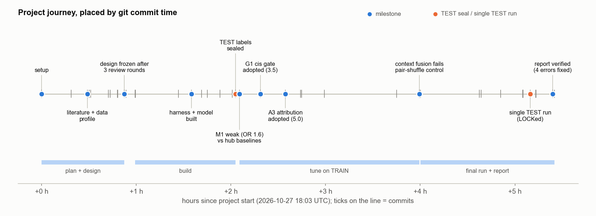
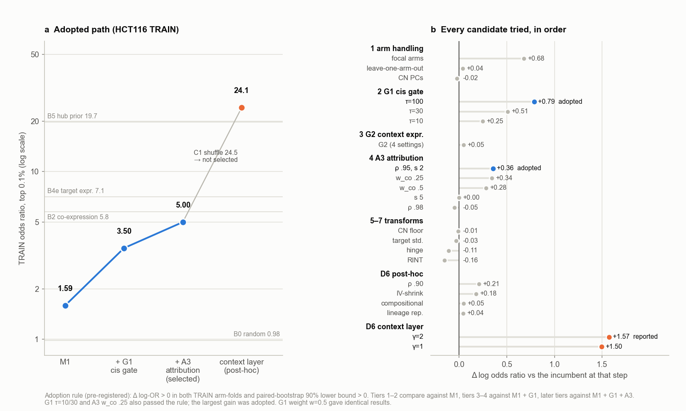

# How we got here

> AI-generated project, not yet verified by a human. See the Disclaimer in the [README](../../README.md).
> Method: [METHOD.md](METHOD.md) · Insights: [INSIGHTS.md](INSIGHTS.md) · Interactive version: [index.html](index.html)

**The final method is what survived three filters:** an association model chosen from the literature before any data
were scored, two add-ons (the cis gate and attribution) that each passed a strict two-fold rule on training regulators,
and controls that showed where every gain came from. The project ran in about 5½ hours on 27 October 2026, driven by
one main AI agent (the "PI") and 19 sub-agents, with no human messages between the brief and the final report.

## Why the method looks the way it does

- **It adjusts for other chromosomes' arms and never for expression factors** because the literature says expression
  factors absorb copy-number effects and arm events are co-selected ([TP1](#tp1)).
- **It is judged on HCT116 with arm-level hold-out and permutation tests** because the data showed the HEK293T screen is
  artefact-dominated and hits cluster on a few regulators ([TP2](#tp2)), and seven reviewer agents rebuilt the
  evaluation ([TP3](#tp3)).
- **It has a cis gate and an attribution step** because reviewers turned the PI's sketches into pre-registered options
  ([TP4](#tp4)), and these were the only two that passed the adoption rule ([TP6](#tp6)).
- **It is reported against hub baselines and within-regulator controls** because a label-free baseline beat the first
  model 12-fold ([TP5](#tp5)) and a diagnosis found no detectable target-level information ([TP7](#tp7)).
- **The context layer is separate** because a control that shuffles targets within each regulator kept its whole
  gain, so the gain came from target detectability, not from copy-number knowledge of specific pairs ([TP7](#tp7)).
- **Its claims are narrow** because the single held-out run was not significant on the headline test, and the direction
  test later failed its negative control ([TP8](#tp8)).

## Eight turning points

Times are UTC on 27 October 2026. "Reviewer" always means an AI reviewer agent. Δ is the change in log odds ratio at the
top 0.1% of pairs.

### TP1 · 18:21 · Use the reduced form, adjust for other chromosomes' arms, never for expression factors

- **Situation and question:** the brief asked for a copy-number→trans-expression model that accounts for cis copy
  number and covariates, and warned that correlated arm events confound. How to remove confounding without removing
  real trans signal?
- **Options:** regress out expression PCs/PEER factors; copy-number PCs; arm copy number of all arms except A's
  chromosome; also adjust A's own arm ("focal"); GLS with a copy-number kinship; per-lineage meta-analysis.
- **Deciding evidence (literature):** copy number correlates with mRNA for 99% of well-expressed genes [F1]; global
  expression correction removes genuine hotspots [K1]; adjusting for phenotype PCs inflates false positives > 10-fold
  [D2]; recurrent arm events in > 30% of tumours with 88 co-occurring pairs [T1, S4, D3]. Reviewers added a LOCO
  aneuploidy burden, TP53, RNA library type and a deletion flag for B.
- **Outcome:** the LOCO reduced form, solved in closed form (matches OLS to 1e-8 on 480 real pairs). Later, focal
  (+0.68, unstable), leave-one-arm-out (+0.04) and CN-PCs (−0.02) failed to beat it.
- **Caveat:** expression-PC correction was never run; "PCs remove real signal" is believed, not shown. The model alone
  was weak (training OR 1.59, p 0.25).
- **Shaped:** [Step 1](METHOD.md#step-s1).
- **Ref:** commits `499dc16` (LITERATURE.md), `a17f5bd` (DESIGN.md v1), `6d755e0`; `results/m4/tier1_compare.txt`.

### TP2 · 18:32 · Data profiling makes HCT116 the primary line and shows the benchmark is hub-dominated

- **Question:** which screened line should be primary, and what does a hit look like?
- **Options:** HCT116, HEK293T, or both equally.
- **Evidence:** in HEK293T 83.0% of trans hits come from perturbations whose own gene is not expressed (12.7% in
  HCT116); HEK293T is not a DepMap line; the top 1% / 10% of perturbations give 55% / 92% of HCT116 trans hits;
  fold-change magnitudes are a pseudocount artefact.
- **Outcome:** HCT116 primary, decided before any model existed; labels use sign and p only; non-expressed perturbations
  became an empirical null; hub concentration motivated TP3's baselines and permutation tests. In hindsight right: the
  method fails on HEK293T (OR 0.49, 6 overlaps).
- **Shaped:** [Evaluation](METHOD.md#step-e), inputs.
- **Ref:** `aacc223` (docs/DATA_PROFILE.md §10–11), decision at `909a6b7`. Data agent.

### TP3 · 18:45 · Review rebuilds the evaluation: arm hold-out, permutation tests, hub baselines, sealed test set

- **Question:** the first design held out 5 Mb bins, used Fisher p-values that assume independent pairs, had only
  variance-based hub baselines and a purity-complete sample set. Which of these would mislead?
- **Options:** hold out bins, ≥ 25 Mb blocks, arms or chromosomes; Fisher, within-regulator shuffle, regulator-label
  permutation or degree-preserving null; 999 or 1,436 lines.
- **Evidence:** copy-number correlation is still 0.56–0.82 at 5–10 Mb, and four reviewers independently proposed an arm
  split; at least four of seven said Fisher p is invalid under pair dependence; the purity-complete set dropped HCT116
  itself, 45% of MSI-high lines and 31% of samples.
- **Outcome:** 14 test / 28 training arms (seed 20261027; median highest test–training CN correlation 0.19, none
  > 0.8); regulator-label permutation and arm jackknife; a shuffled-copy-number control; target-expression and hub-prior
  baselines; 1,436 lines; test labels moved out of the repository, made unreadable, hashes committed.
- **Not adopted, and it mattered:** the statistics reviewer's proposal to tune on a within-regulator metric (CMH). The
  PI kept the pooled odds ratio because the brief asks for enrichment. **Cost:** 14 test arms give wide intervals.
- **Shaped:** [Evaluation](METHOD.md#step-e), sample set.
- **Ref:** `6d755e0`, `9f7d21a`, `a6ccaeb` (frozen), `57fbe32` (split), `57f2de3` (sealed); reviews/round1/*.md.

### TP4 · 18:55 · Reviews turn the PI's sketches into a cis gate, a closed-form attribution and a sign rule

- **Question:** the first design sketched an instrument gate, a co-expression "mediation" score and a softmax over
  co-segmented genes, with direction = sign of the association. How to specify each?
- **Options:** hard gate or two-stage score; mediation, softmax, iterative SuSiE or closed-form single-effect
  fine-mapping; raw, instrumental-variable or shrunk cis sign.
- **Evidence:** instrument logic and weak-instrument bias [G2, B2]; the only strong published Perturb-seq enrichment is
  cis-anchored (OR 12.4 on 41 pairs [W1]); a statistics reviewer proposed an F floor of 10 (the PI wrote the grid
  10/30/100); the algorithms reviewer proposed the closed-form Bayes factor with one effect and warned the prior would
  decide; co-expression does not track perturbation effects [A1]; ~95% of genes rise with their own copy number; a
  fresh round-3 reviewer caught contradictory sign rules and an undefined final score.
- **Outcome:** gate, expression-context gate and attribution became pre-registered, hash-locked options with fixed
  grids; the sign rule was unit-tested.
- **Shaped:** [Step 2](METHOD.md#step-s2), [Step 3](METHOD.md#step-s3), [Step 4](METHOD.md#step-s4).
- **Ref:** `6d755e0`, `9f7d21a`, `a6ccaeb`; DESIGN.md §1, §5.3–5.6; reviews/round1/statistics.md #6–8,
  algorithms_compute.md #8–9; results/variants.yaml.

### TP5 · 20:08 · First training numbers: a DepMap-only hub prior beats the copy-number model 12-fold

- **Question:** does the frozen core model enrich Perturb-seq pairs at all?
- **Evidence (training OR):** core model 1.59; hub prior 19.7; target expression in HCT116 7.1; co-expression 5.8;
  random 0.98; shuffled copy number 0.75; arm only 0.97. Target expression alone, with no pair information, scored CMH
  3.8, so the pre-registered within-regulator statistic did not remove detectability.
- **Outcome:** the PI ran the pre-registered tuning as written and recorded that pooled enrichment is mostly hubness and
  detectability. The hub prior was specified at round 1 but computed only after the freeze.
- **Shaped:** [Evaluation](METHOD.md#step-e) (how results are read).
- **Ref:** `f2deb85`; results/m4/mvp_full_hct116.txt.

### TP6 · 20:21 · The cis gate is the one large, stable gain; attribution helps through its prior

- **Question:** which pre-registered option survives the adoption rule (gain in both training folds and paired 90%
  bootstrap lower bound > 0)?
- **Evidence:** gate F ≥ 10 / 30 / 100: +0.25 / +0.51 / **+0.79** (folds +0.65 / +1.12, lower bound +0.56; target-level
  −0.05); expression-context gate +0.05 (redundant); attribution **+0.36** (folds +0.43 / +0.28, lower bound +0.04),
  finer blocks −0.05, flatter prior 0.00; target standardisation −0.03, loss-only slope −0.11, transforms −0.01 / −0.16.
- **Outcome:** gate and attribution adopted, the leave-own-chromosome-out arm adjustment kept; training OR 5.00; 23 of 30 configurations used. TP7 later
  showed attribution acts almost like a hard choice of the strongest-cis gene.
- **Shaped:** [Step 2](METHOD.md#step-s2), [Step 3](METHOD.md#step-s3), [Step 1](METHOD.md#step-s1) (kept).
- **Ref:** `6288007`, `c968b1d`, `48143dc`; results/tuning/tier2_G1_compare.json, tier4_A3_compare.json.

### TP7 · 20:47–22:02 · Diagnosis: no detectable target-level information, so the detectability fusion becomes a separate layer

- **Question:** the best model sat far below the hub prior (−1.37). Chase pooled OR with the last 7 configurations, and
  how to credit any gain?
- **Evidence (fresh "ideas scientist" agent, training only):** within-regulator AUROC 0.507 (target expression in
  HCT116: 0.70); ~94% of log-enrichment is regulator choice; a gated regulator's t-row correlates with its arm's at
  median r = 0.87. It proposed two controls: shuffle each regulator's scores among its targets within 50 expression bins
  (C1), and apply any fusion to shuffled-copy-number statistics (C2).
- **Options tried (post hoc, label-free):** compositional TPM correction +0.05; coarser blocks +0.21 (unstable); shrunk
  instrumental-variable score +0.18 (target-level +0.42); lineage replication +0.04; detectability fusion +1.57
  (training OR 24.1).
- **Outcome:** the fusion passed the rule but the exact target shuffle gave the same OR (24.5; Δ −0.02, CI −0.09 to
  0.06). The selected method stayed copy-number-only; the fusion ships as the context layer. A loader bug had first made
  the control show a spurious +0.063 gain; fixed before the decision.
- **Missed chance:** a round-1 reviewer had proposed this target prior ("likely the largest OR gain"); the design marked
  it "covered" by regulator-side baselines, which it was not.
- **Shaped:** [Step 5](METHOD.md#step-s5), [Evaluation](METHOD.md#step-e) (controls), interpretation of
  [Step 3](METHOD.md#step-s3).
- **Ref:** `d4bdd91`, `704aac0` (reviews/ideas/M5a_ideas.md), `f209390`, `d439c58`; results/tuning/d6_*.json.

### TP8 · 23:12 · One sealed test run: the gate replicates, the headline is not significant, the claims narrow

- **Question:** does the training selection hold on held-out arms, and what may be claimed?
- **Safeguards:** a fresh pre-final reviewer mocked the final run from a clean clone and required three fixes (sealed-file
  hash check, a missing-value guard, missing context-layer comparisons); selection and LOCK committed before any test
  file was read.
- **Evidence (HCT116 test):** OR 3.85 (CI 1.33–11.2), p = 0.068; gate ablation 1.46 → 3.85, +0.97 (CI 0.30–1.64);
  within regulator AUROC 0.500, CMH 0.94, target shuffle 3.76; context layer 18.4 vs hub prior 22.8. A fresh verifier
  found 4 errors and 3 over-claims among ~120 report numbers.
- **Outcome:** claims narrowed to: copy number may help identify *which regulators* have detectable trans effects
  (resting mainly on the gate's replicated gain), not *which targets*. A "modest" direction effect was also claimed
  at the time. **Correction (28 Oct, D9):** the shuffled-copy-number fusion control passes the same direction test
  (p = 0.001), so direction is now reported as not established.
- **Shaped:** [Evaluation](METHOD.md#step-e), [Step 4](METHOD.md#step-s4) (status of direction),
  [Step 2](METHOD.md#step-s2) (replicated).
- **Ref:** `7b4dba9`, `5d92561`, `62e67b9`, `603a7f5` → `e9085c7`, `b0827fd`; results/final/summary.md; RESEARCH_TREE.md D9.

### Who contributed which idea

| component | first source |
|---|---|
| No expression factors; other-arm adjustment | literature [F1, K1, D2, T1, S4, D3] and the brief's warning about arm events |
| Aneuploidy burden, TP53, RNA library type, B's deletion flag | domain and statistics reviewer agents, round 1 |
| Cis gate | literature [G2, B2, W1]; the PI's first design; prior-work and statistics reviewers |
| Single-effect attribution, closed-form Bayes factor | SuSiE [W4]; closed form from the algorithms reviewer |
| Shrunk sign rule | domain and statistics reviewers |
| Arm hold-out, regulator permutation, sealed test, hub baselines | four reviewers independently (arm split); statistics (permutation); AI-failure-modes (seal); prior-work and external-PI reviewers (baselines) |
| Target-shuffle and shuffled-CN fusion controls; context layer | ideas-scientist agent; target prior first proposed by a round-1 reviewer |

## How the research was actually done

**One main agent did the deciding and all the record-keeping; sub-agents did literature, data, building and, above all,
criticism.** The most consequential ideas came from reviewers and a late "ideas scientist".

| | |
|---|---|
| Wall-clock | ≈ 5 h 30 min, brief 17:58 to close 23:28 |
| Sub-agents | 19 (14 Opus, 5 Sonnet); 16 follow-up messages |
| Commits | 40, all from the main agent's shell |
| Tuning configurations | 29 of 30 (23 pre-registered, 6 post hoc) |
| Test runs | 1 locked run, 55 evaluations in 4.5 min |
| Human messages between brief and report | 0 |

- **Main agent (PI):** wrote the design and every revision, every decision note, the tuning loop and every adopt/reject
  call; ran the seal, the mock and the final run.
- **Sub-agents:** literature (59 web-verified references); data (the profile behind TP2); 13 design-review runs
  (statistics, data, domain biology, prior work, algorithms, AI failure modes, external PI); builders working in
  parallel against fixed interfaces (~70 min, no integration rework); two code reviewers who re-implemented components
  and found a blocker; the ideas scientist (TP7); a pre-final reviewer and a report verifier.
- **Productive:** parallel narrow-remit reviewers; independent re-implementation in code review; the two-fold adoption
  rule (it rejected two unstable gains, and the gain it adopted replicated); the one-shot test protocol.
- **Circular or wasteful:** round 3 had to fix contradictions round 2 introduced; baselines were specified but not
  computed before the freeze; a reviewer's target prior was dismissed and returned post hoc 2.5 h later; the 75-min
  post-hoc tier changed nothing in the selected method (but produced the key diagnosis); several controls had no
  known-answer test before first use; tuning on pooled OR meant only regulator-level gains could be adopted.
- **Human input:** the brief (PROMPT.md) set substantive priors (model cis copy number; trans = different chromosomes;
  arm events confound; copy loss ≈ knockdown; hold out perturbed genes; "maximise enrichment", which drove the pooled
  objective). After the project, the human asked for a private repository with a disclaimer, and for this write-up.
- **Why it stopped:** after the locked test, further changes could not be validated without a new hold-out.

## Appendix: dead ends

Training Δlog-OR versus the best model at the time; adoption needed both folds > 0 and a paired 90% bootstrap lower bound
> 0. Values follow the verified fact sheet (docs/explainer/FACTS.md); `dead_ends.md` quotes jackknife bounds for some rows.

**The two that taught something**
- **Detectability fusion** (+1.57, folds +1.37 / +1.82): passed the rule, failed the target-shuffle control. A strict
  rule on a pooled metric does not protect against winning through hubness. Kept as the context layer ([TP7](#tp7)).
- **Focal arm handling** (+0.68, folds −0.09 / +1.52): rejected as unstable; on test 4.50 vs 3.85, not significant.
  Large one-fold gains on a hub-dominated benchmark are usually noise.
- **Near miss: shrunk instrumental-variable score** (+0.18, folds +0.10 / +0.29, lower bound −0.07): the only option
  that improved within-regulator ranking (+0.42). Best candidate for a fresh hold-out.

| stage | option | Δlog-OR | why it failed |
|---|---|---|---|
| arm handling | leave out only A's arm | +0.04 | no gain |
| arm handling | 20 copy-number PCs | −0.02 | no gain |
| context gate | require A expressed in HCT116 (4 settings) | +0.05 | redundant after the cis gate |
| attribution | finer blocks (r 0.98) | −0.05 | blocks too fine |
| attribution | flatter prior (scale 5) | 0.00 | loses the regulator-choice effect |
| attribution | co-expression weight 0.5 / 0.25 | +0.28 / +0.34 | 0.5 failed the bound; 0.25 lost to no weight (+0.36) |
| scoring | standardise each target | −0.03 | no gain |
| scoring | loss-only slope | −0.11 | lost power |
| transforms | lower CN floor; rank-normalise | −0.01 / −0.16 | no effect / worse |
| post hoc | compositional TPM correction | +0.05 | neutral on ranking |
| post hoc | coarser blocks (r 0.90) | +0.21 | one-fold gain (−0.04 / +0.51) |
| post hoc | replication in two lineage halves | +0.04 | power loss cancels specificity |
| post hoc | graded regulator-context prior | — | not run: rule unmeetable by construction |
| design | 5 Mb bins; purity-complete set; mediation score; per-lineage meta-analysis | — | leakage; drops HCT116; is co-expression; too few lines per lineage |
| evaluation | thresholded call set | test 1.15 | 10.7 M calls; ranking is better |
| secondary line | HEK293T | test 0.49 | not a DepMap line; artefact-dominated hits |

## Appendix: corrections to earlier project documents

- **Direction.** TP8's original outcome, `journey_timeline.json`, `worked_example.md` and the explainer insight notes
  said copy number "modestly" predicts direction (those notes were corrected on 28 Oct). Correction D9 supersedes
  this: direction is not established. The RESEARCH_TREE.md status summary still carries the old wording.
- **Runtime.** REPORT.md once said "52–91 s across all model variants, plus about 30 s of data loading". Model runs span
  27.5–151 s; 52–91 s is the range within the final evaluation; loading takes ~1 s and is inside the 67 s.
- **Gate gain.** +0.79 is adding the gate to the core model; the training analogue of the test ablation is +0.91.
- **Training p = 0.005** is the floor of a 200-permutation test.
- **Terminology.** In the Perturb-seq files "target" is the *perturbed* gene; "83% of hits from non-expressed targets"
  means non-expressed *regulators*.
- **Lower bounds.** TP6 notes quote a jackknife bound (+0.61) for the gate; the adoption rule used the bootstrap bound
  (+0.56).
